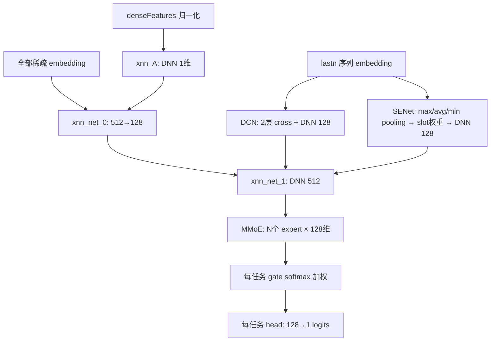

# DCN 模型结构解析（mall_rank_v10_dcn）

> 代码位置：`rank_ctr_exp_mall_cvr_label/estimator_dcn.py`（lingyu 工作区）
> 整理日期：2026-10-13

## 概述

这份代码中的 DCN **不是一个独立模型**，而是作为电商导购多任务排序模型中的一条「特征交叉分支」，与 wide&deep 分支、SENet 分支并联后进入 MMoE，最终由多个任务头分别输出 logits（click / buy / cart / wish / buy_now / all_click 等）。

## 1. Cross Layer（DCN 核心）

核心为 `cross()` 函数，单层公式：

```python
out = tf.multiply(x0, tf.reduce_sum(tf.multiply(xl, w), axis=1, keepdims=True))
out = tf.nn.elu(tf.add(out, b))
out = tf.add(out, xl)   # 残差连接
```

即：

```
x_{l+1} = x0 ⊙ (x_l · w) + b   →  ELU  →  + x_l（残差）
```

关键点：

- `x0` 是原始输入（每层都参与，始终不变），`x_l` 是第 l 层输出
- `w`、`b` 形状均为 `(1, dims)`，即每层只做**向量内积形式的标量门控**（bit-wise 交叉），参数开销很小
- 训练时带 dropout（keep_prob = 0.95）

`_dcn_model()` 中堆叠了 **2 层** cross layer：

```python
cross_out = cross(x0, x0, "dcn_layer_1")
cross_out = cross(cross_out, x0, "dcn_layer_2")
```

### 与原版 DCN 论文的区别

标准 DCN cross layer 为 `x_{l+1} = x0 · (x_l^T w) + b + x_l`，无非线性激活。这里的变体：

- 每层加了 **ELU 激活**
- 训练时加了 **dropout**
- 残差连接保留

## 2. DCN 分支的输入与输出

**输入**：`lastn_senet_list`，包括：

- 所有 lastn 行为序列特征 embedding（`lastnGoodsid` / `lastnSpuid` / `lastnOrder*` / `lastnCart*` 等，剔除 `Quer` / `Fls` / `Hit` 类）
- 用户/物品侧关键特征：`trackId`、`user_id`、`gender`、`age_bucket`、`user_frequent_city`、`user_frequent_province`、`spu_id`、`brand_id`、`seller_id`、`goods_name_tokens`、一/二/三级类目、`priceOriginBucket`

约 44 个 slot × 64 维，concat 成约 2816 维向量。

**输出**：cross 结果再过一层 `[128]` 的 DNN（`dcnnet_output`），得到 128 维向量，放入 `embs["dcn_net"]`。

## 3. DCN 在整体结构中的位置

整体数据流（`build_net()`）：



1. **并联三路**：
   - wide&deep 主路：dense 特征过 `xnn_A`（1 维）后与全部稀疏 embedding concat，过 `[512, 128]` DNN
   - DCN 交叉路：对 lastn 序列与核心 ID 特征做显式高阶交叉，输出 128 维
   - SENet 特征加权路：对 lastn embedding 按 slot 做 max/avg/min pooling → concat → `[64, slot_dim]` DNN + sigmoid 得到每个 slot 的权重 → 加权求和 → `[128]` DNN
2. 三路 concat 后过 `[512]` DNN（`xnn_net_1`）
3. **MMoE 多任务**：expert 数 = 任务数，每个 expert 128 维；每个任务一个 softmax gate 对 expert 输出加权
4. **任务头**：每个任务独立的 `[128, 1]` DNN 输出 logits，`binary_classification_head` 计算 sigmoid 交叉熵；支持任务间蒸馏（`distill_q`，distill_r = 0.5）

## 4. 训练配置

- 优化器：Adam（lr = 2e-4，beta1 = 0.9，beta2 = 0.9999）
- 只更新 `models/` scope 下的变量（embedding 走另外的更新链路）
- 损失：sigmoid cross entropy；部分任务支持正负样本加权（`weight_boost`）
- BatchNorm 用于各隐藏层，需处理 `UPDATE_OPS` 依赖

## 5. 总结

这个「DCN」实际是 **DCN 交叉模块（2 层 cross，带 ELU / 残差 / dropout）+ SENet + wide&deep + MMoE 多任务** 的组合结构：DCN 只负责对 lastn 序列与核心 ID 特征做高阶显式交叉，产出 128 维特征向量，作为 MMoE 的输入特征之一，而不是经典 DCN 论文中 cross network 与 deep network 并联后直接出分的完整结构。
